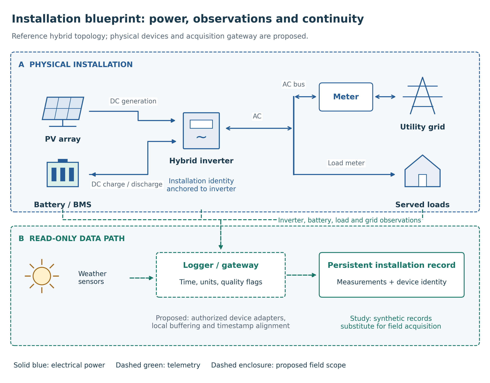
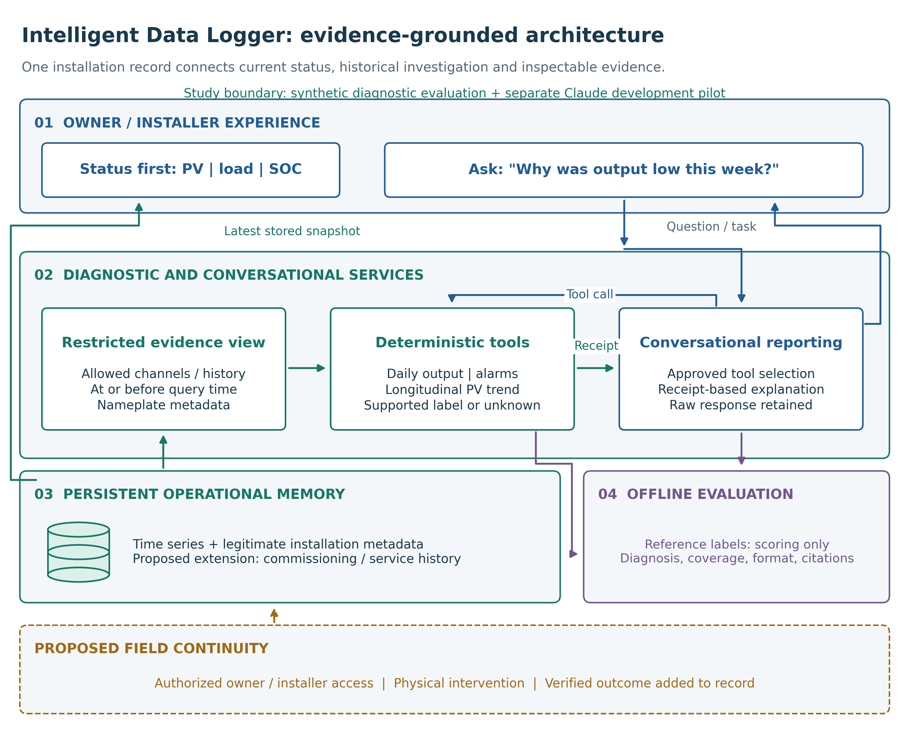

# Proposed system architecture

Design context from the original project brief; not evaluated field capabilities and not part of the v6 methodological contribution.

The architectural organizing principle is one persistent record for one physical installation, anchored to its inverter identity. In the proposed deployment, PV generation, battery state, grid exchange, served load and environmental observations enter that record through verified, read-only adapters. The diagram shows a reference DC-coupled hybrid topology, not a wiring specification or a tested device configuration. A replacement inverter or changed battery would require an explicit identity and configuration history rather than silently starting an unrelated record. Retaining commissioning details, maintenance events and verified interventions across the installation lifetime is a proposed extension; this study evaluates finite synthetic histories, not lifetime operation.

Further proposed functions include authorized phone access, remote installer pairing and verified maintenance feedback. None was validated in the synthetic study. The current software offers a stored synthetic status view and tool-based conversation.

The figure generator is scripts/build_architecture_figures.py.
