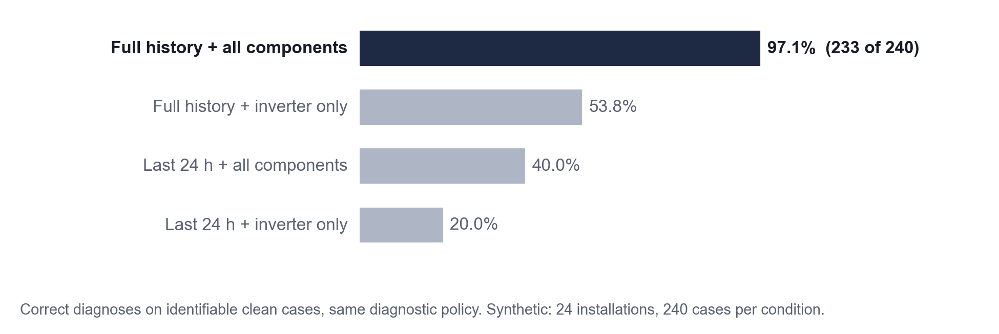
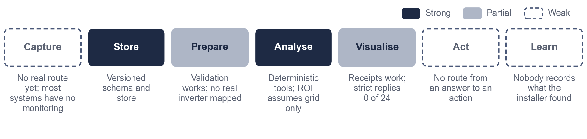
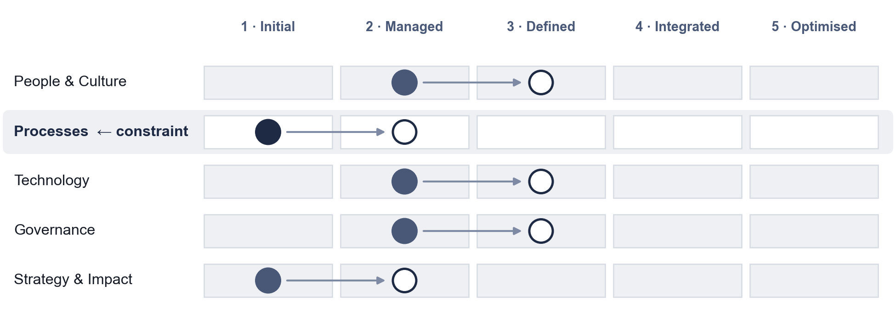
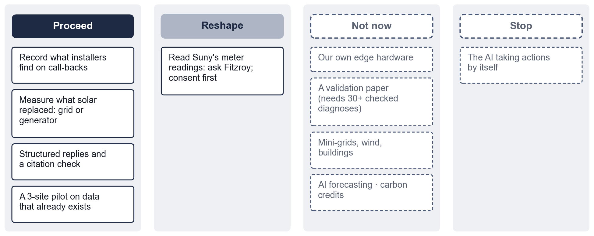
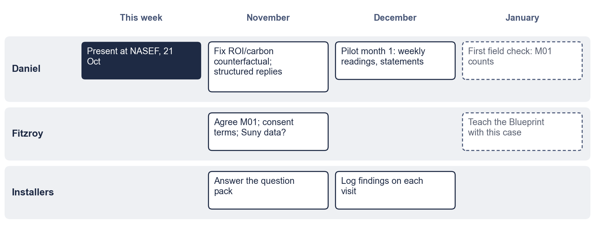

# The one thing to see differently

The obvious next step for an AI data logger is more AI, or our own hardware. The evidence points somewhere else. On synthetic data, our method gets 233 of 240 diagnoses right when it can see history across all components. In the field, we would have no way to know whether a diagnosis was right, because **nobody writes down what the installer actually found** when they go back. Six of the seven installers asked had one or two such return visits a year. Those visits are the cheapest ground truth there is. The first thing to collect is a two-line note, not more telemetry.

# Our vision

> We aim to show that a solar data logger can answer an owner's questions with evidence a stranger can check, by running our method on a few real installations whose installers record what they actually found, so that problems are fixed before the lights go off and the savings are there to see, without claiming field accuracy before we have measured it, letting the AI make the engineering call, or building hardware before the data we already have has been tried.

For the team wall: **no answer without evidence; no claim without a field check.**

# Where we are today

**What changed since August.** The plan was to validate an intelligent layer on real data. The paper now presents a reproducible method with a synthetic worked evaluation. That is the claim the evidence supports. Validation becomes the field phase.

**Limiting constraint: Processes.** No real data has flowed through the IDL yet. Strategy & Impact ties at Level 1 and depends on it.

**Easy to miss:** even a perfect feed would leave the Learn step empty. Without recorded installer findings, no diagnosis can be checked.

# How we will know it's working

**North Star: field-confirmed diagnoses (M01):** diagnoses whose cause matches what the installer recorded on site. Counts, not percentages, until there are 30.

| Metric | Today | Decision it informs |
|---|---|---|
| M01 Field-confirmed diagnoses | No data | Does the method work in the field? |
| M02 Sites with a usable weekly feed | No data | Is the manual or export route viable? |
| M04 Replies in the required structure | 0 of 24 | Can conversational answers be scored? |
| M05 Replies citing only real measurements | 15 of 24 | Can the prose be trusted? |
| M06 Days from fault to detection | Synthetic only | Is early detection real? |
| M07 Installers agreeing to host a site | Pack ready | Pilot size and timing |
| M08 Cost per site per month | Model about USD 0.21 per 24 conversations | Affordable without funding? |

Removed as vanity: tools built, rows generated, tests passed, dashboard visits.

# What we fix first

- **Record what installers find on call-backs (I01).** A two-line note per visit. It makes M01 measurable.
- **Measure what solar replaced (I02).** The same 1,851 kWh pays back in 5.1 years against the grid or 0.9 years against a petrol generator. CO₂ avoided is 883 kg vs. 3,481 kg. The logger can see when the grid was on.
- **Structured replies with a citation check (I03).** The clearest measured failure.
- **A three-site pilot on data that already exists (I04).** Weekly photos of the inverter counter, plus exports where available. No new hardware.

# What we will not do yet

- Claim field accuracy, or that the IDL speeds up solar adoption.
- Build our own edge hardware before the existing data routes are tried.
- Let the AI take actions: dispatch, shutdown or ordering. It explains; people decide.
- Publish any site's data, or send personal data to the model.
- Claim carbon credits, or extend to mini-grids, wind or buildings.

# Next 90 days

| Action | Owner | By | How we'll know it worked |
|---|---|---|---|
| Present the methodology at NASEF | Daniel | 21 Oct | Questions recorded; at least one contact for a pilot site |
| Send the installer question pack | Daniel | 31 Oct | M07: answers from at least 5 installers |
| Fix the ROI and carbon counterfactual; use the 0.477 grid factor | Daniel | 15 Nov | The O2 statement shows the grid and generator split |
| Structured final replies plus a citation check | Daniel | 30 Nov | M04 above 22 of 24 on the pilot set |
| Agree M01, consent terms, and whether Suny readings can be used | Fitzroy | 15 Nov | A signed one-page consent note |
| Pilot month 1 at 3 sites | Daniel | 31 Dec | M02: 2 of 3 sites with 28+ days |
| First field check | Daniel | 31 Jan | M01 counts reported, with n |
| Teach the Blueprint with this case | Fitzroy and Daniel | Jan | The first workshop runs |

# Open questions

| Question | Who |
|---|---|
| Talk length and any organiser template | Daniel |
| The radio-station story: may we tell it, unnamed, with a few numbers? | Daniel |
| Which survey item showed low maintenance habits, and how many of how many said so? | Daniel |
| Is "Datalodger" a product, a partner or an earlier name? | Daniel, Fitzroy |
| Consent and data rights under the NDPA 2023 | Fitzroy |
| Which installers will host, and which inverters do their customers have? | Installers |

*Prepared with the Petgrave.io™ Data Strategy Blueprint. Working files: `docs/data-strategy/` (stage files, evidence register, questions, links). All IDL results are synthetic unless stated; small samples are reported as counts.*
