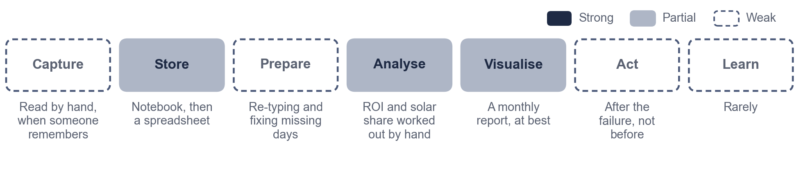
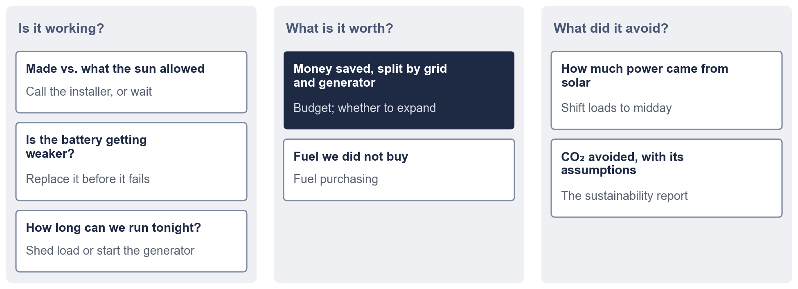
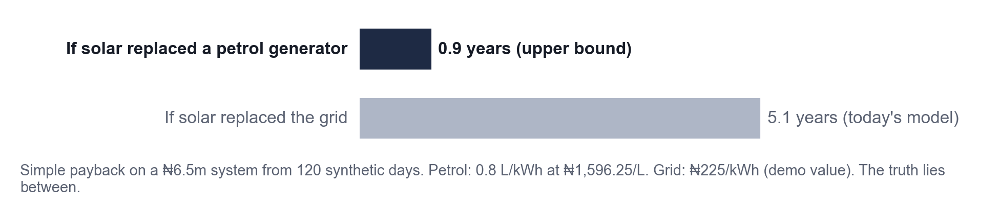
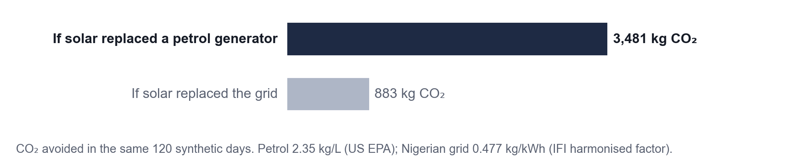
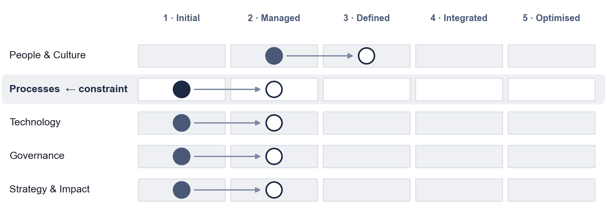

# The one thing to see differently

At a radio station running solar, grid and a generator, the energy record was a notebook. Someone read the inverter, the meter and the generator hours, wrote them down, and later worked out by hand what solar had saved and how much of the power it supplied. The system was already keeping its own diary. Nobody could read it. **The problem isn't a lack of data. A person still has to collect it, write it down and work it out.** When that person is busy, the record has gaps. When they leave, the organisation loses its memory of how its power behaves.

# Our vision

> We aim to know every month whether our solar is working, what it saved us and what it kept out of the air, by letting the logger keep the record we used to write by hand, so that we fix problems before they take us off air and can show management the numbers, without trusting any figure whose assumptions we can't see or sharing our data without our say.

In an energy manager's words: *"I used to spend my evenings with the logbook. Now I read the statement, ask why if something looks odd, and call the installer before the power goes."*

# The questions you can ask

Each question changes a decision. On synthetic data, the logger already answers most of them, with the evidence behind each answer.

# The number that is most often wrong: what solar saved you

What solar saved depends on what it replaced. When the grid is on, solar replaces the tariff. When the grid is off, it replaces generator fuel, which costs several times more. Most calculations, including our own first version, assume the grid.

The logger records when the grid was present. That makes the split measurable, not guessed. Every figure it gives you shows the price, the fuel rate and the emission factor it used.

# Where you probably are today

The next level is modest: **one complete record every week without anyone writing it down**, and one decision a month made from the numbers.

# What we will not do

- Show you a number without the assumptions behind it.
- Switch your equipment or your generator by itself.
- Share your energy data without your written yes. Energy data shows when people are present.
- Promise real-time alerts where there is no connection. A weekly record is enough to start.

# What happens next

| Step | What you do | What you get |
|---|---|---|
| 1 | Photograph the inverter counter once a week, or share the app export | A complete record |
| 2 | Note generator refills and grid outages | Savings split by grid and generator |
| 3 | Ask your installer to write two lines when they visit | Diagnoses that can be checked |
| 4 | Read the monthly statement; ask "why?" | Problems found before they take you off air |

*Prepared with the Petgrave.io™ Data Strategy Blueprint. The radio-station case is reported from experience, not measured. All logger results shown are from synthetic data until the pilot runs.*
