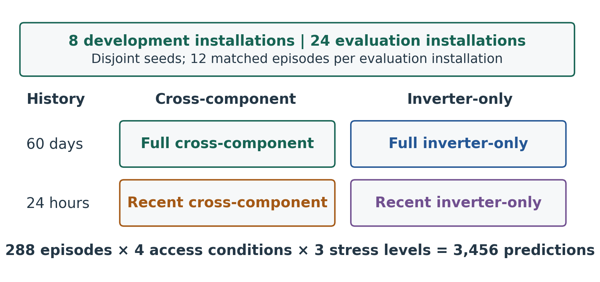
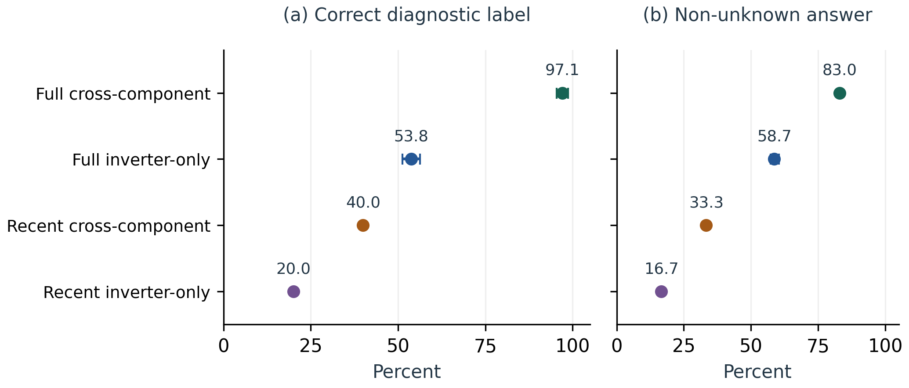
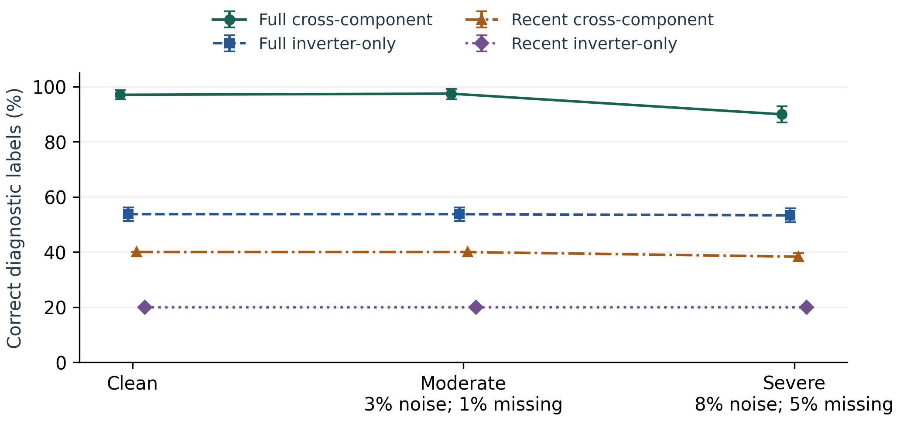
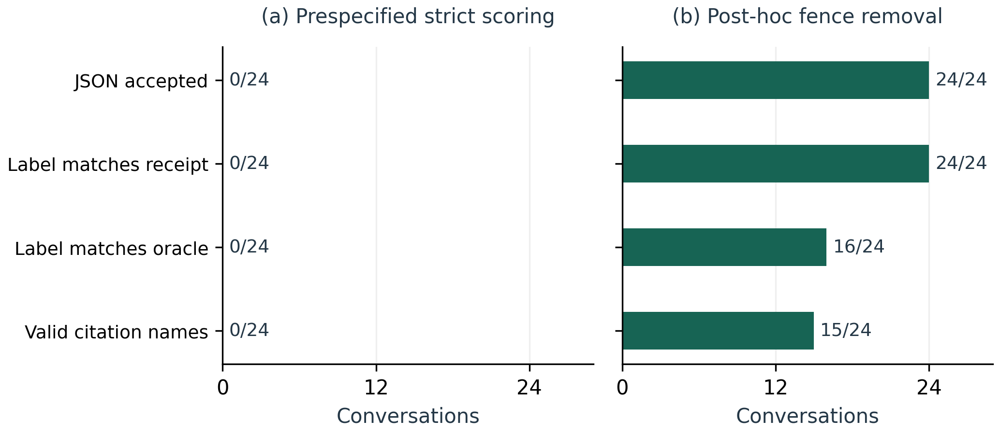

# A reproducible methodology for evidence-grounded conversational diagnostics of solar PV–battery systems: implementation and synthetic evaluation

Oyewale, D.O.¹ and Meyer-Petgrave, F.¹

¹Petgrave.io Technologies Ltd, Nigeria

## Abstract

Solar adoption in Nigeria is growing quickly, raising a need for care after installation. We hypothesize that many installed systems lack active monitoring after handover, allowing faults and gradual performance loss to go unnoticed and potentially weakening the trust that further adoption depends on. The prevalence of this monitoring gap and its effects on trust are not measured here. We propose that conversational AI built on a continuous data record can support proactive care: an owner or installer asks a plain-language question and receives an answer that cites its supporting measurements or acknowledges that the data cannot resolve the question. The methodology places this intended behaviour within a measure-record-diagnose-explain-act-verify loop; physical acquisition, intervention and outcome verification remain proposed. No field data were collected.

A controlled synthetic evaluation used twelve matched episodes for each of 24 evaluation installations, separate from eight development installations. Four information-access conditions and three observation-quality levels produced 3,456 paired predictions. Clean full-history cross-component access correctly diagnosed 233/240 identifiable cases (97.1%; 95% installation-bootstrap interval: 95.4–98.8%), compared with 53.8% for historical inverter-only and 40.0% for recent cross-component access. Severe corruption reduced full-access accuracy to 90.0%.

A separate 24-conversation Claude development pilot selected the intended tool throughout but failed the strict JSON contract in every response. Post-hoc fence removal recovered 24 receipt-consistent labels; 15 responses passed the citation rule. The contribution is a reference implementation and evaluation procedure that exposes diagnostic and reporting limitations. Shared simulator–policy assumptions and absent field validation limit generalization. A proposed Nigerian field workflow specifies acquisition and independent fault references; effects on incidents, user trust and adoption remain untested.

Keywords: solar diagnostics, reproducible methodology, evidence grounding, conversational diagnostics, synthetic evaluation

## 1. Introduction

Solar adoption needs care after installation. The Global Solar Council reports that Nigeria added 803 MW of solar capacity in 2025 [11]. As more households and businesses rely on solar, installation handover is only the beginning of the system's working life. Maintenance capacity also matters: a Lagos labour-market assessment, reported by THISDAY, found that 58% of surveyed technicians had received solar-related training [12]. This local, reported finding is not a national estimate or a measure of installation safety, but it motivates tools that support technicians with accessible engineering evidence.

Our motivating hypothesis is that many small installations are not actively monitored after handover. Faults and slow performance decline could then remain unnoticed until a visible failure occurs. Such failures may weaken confidence in solar and the trust on which further adoption depends. These are concerns to investigate in the proposed field study, not measured prevalence or causal findings from the present synthetic experiment.

Consider an owner who asks, "Why was my output low this week?" A cloudy week, a conversion problem and a gradual performance decline can produce similar changes in an output chart. Without an adequate record and the relevant measurements, neither a confident answer nor an attractive dashboard resolves the ambiguity. A failed or unsafe installation may weaken confidence in solar; the possibility that better aftercare supports trust motivates this work, but that causal relationship is not measured here. We do not assume a known national rate of unmonitored systems or that installers can substitute software for physical inspection.

Our proposal is a persistent installation record with a conversational interface through which an owner or installer can investigate the evidence. The intended answer identifies its supporting measurements and acknowledges when they cannot resolve the question. Scheduled checks may flag developing problems, while a conversation can explain the resulting evidence. We describe this prospective care cycle as measure, record, diagnose, explain, act and verify. The present study implements and evaluates its software evidence path using synthetic observations; it does not close the physical intervention loop or demonstrate fewer incidents.

Established PV modelling represents environmental effects on output [1,2], degradation analysis uses longitudinal records [3], and language-model tool use is established [4,5]. Our contribution is a reproducible methodology joining controlled evidence access, deterministic diagnostic receipts and separate assessment of conversational reporting. The worked evaluation distinguishes what the diagnostic policy can conclude from whether a model reports that conclusion faithfully. It is a methodology demonstration, not a claim that these individual components are new.

The intended users include owners and installers in Nigeria, but no Nigerian field measurements, hardware prototype or installer trial are reported. RQ1 asks how historical access affects correct diagnosis; RQ2 asks how bundled cross-component access affects correctness and false positives; RQ3 asks how observation noise and missingness affect these outcomes. A secondary post-hoc analysis examines automated-check timing; it is summarized briefly and documented separately in Supplement S1. A separate development pilot tests tool selection, output-format compliance and evidence citations. A proposed field-acquisition pathway explains how subsequent work could replace simulated observations with verified device measurements and independent fault references.

## 2. Related work and contribution boundary

The Sandia photovoltaic array performance model describes electrical, thermal and optical behaviour for performance prediction and measurement comparison [1]. The pvlib python software provides reusable solar-energy modelling implementations [2]. These works establish a substantial modelling foundation; our deliberately simplified project-authored generator does not replace their physical detail or inherit their validation. It provides matched interventions for an information-access experiment, with physical consistency checks and disclosed assumptions.

Jordan et al. [3] developed a degradation methodology addressing operational confounders using clear-sky irradiance and year-over-year analysis, demonstrated on a fleet of 486 PV systems. Accordingly, history-dependent PV diagnosis and weather normalization are not novel claims of this paper. Our 60-day synthetic decline task is a controlled signature test, not an annual field degradation estimator. No performance comparison with RdTools is made.

ReAct combines language-model reasoning and actions to obtain external information [4]. Toolformer studies learning to select and use APIs [5]. Our system instead uses an existing tool-capable model with a small, fixed engineering-tool interface. The pilot forces one tool call and then requests a structured explanation; it does not reproduce those training methods or establish autonomous diagnostic reasoning. The computational boundary keeps engineering quantities in deterministic code and exposes their provenance to the conversational layer.

PV fault diagnosis already includes explainable interfaces. Utama et al. [9] compare SHAP, Anchors and DiCE explanations for a neural-network PV fault detector. Sairam et al. [10] describe a hybrid physical-model/XGBoost detector with LIME explanations in a preprint. These studies establish relevant application precedents. Our evidence receipts record deterministic measurements and decision criteria rather than post-hoc feature attributions; the present experiment separately manipulates evidence access and scores conversational reporting. We do not compare diagnostic performance with these systems or claim that our explanations are more useful to installers.

Selective classification illustrates why performance on answered cases must be interpreted together with coverage [6]. We apply that distinction descriptively to a deterministic policy with explicit unknown outcomes, without claiming the statistical risk guarantees of selective-classification methods. Our methodological contribution is the combination of explicit data-access boundaries, inspectable evidence receipts, reproducible information-access evaluation and separate assessment of conversational reporting. The software is a reference implementation; the synthetic study and failure-transparent pilot demonstrate its use rather than establish field effectiveness. This targeted comparison of primary sources does not establish an exhaustive literature gap or a first-of-its-kind system.

## 3. Proposed methodology and worked evaluation

### 3.1 The care loop and evidence boundary

The care loop gives the engineering pipeline a practical purpose. Measure obtains observations from the installation; record preserves and aligns them; diagnose computes a supported label or unknown; explain makes the evidence available through conversation; act is the owner's or installer's response; verify records whether the intervention resolved the problem. Figure 1 marks the implementation boundary. Here, synthetic generation supplies observations in place of physical measurement. Record and diagnose are implemented; explain is implemented but its reporting contract failed in the pilot. Field acquisition, physical action and post-intervention verification remain proposed.

The pipeline separates clean physical trajectories, corrupted observations, condition-specific access, deterministic diagnosis and oracle-based evaluation. The oracle stores injected causes and simulation parameters solely for scoring. The diagnostic function receives an allowed telemetry view, legitimate nameplate information, a task and fixed thresholds; the implementation performs no file reads or simulator imports. This describes the code path, not a separately enforced security sandbox. An evidence receipt is the structured output of a diagnostic tool: in the benchmark it contains the decision label, reason, supporting measurement dictionary, available columns and row count, evaluated time window and thresholds. Modelling assumptions are recorded in the protocol and tool definitions; the benchmark receipt does not contain a separate assumptions field. No scenario identifier, seed, latent state, oracle label or future row is supplied to it.

The conversational layer selects an approved tool and receives its receipt rather than raw time series. The operational dashboard displays the latest complete stored synthetic snapshot and supports investigations. A separate public experiment explorer presents archived evidence and comparative results. Neither a website interaction nor an interface screenshot is counted as a research trial. Figure 2 summarizes the evidence and evaluation boundary.

### 3.2 Evaluation workflow and implementation boundary

The evaluation procedure implements the evidence path within the care loop. First, define each diagnostic task and its required measurements, units, history and legitimate installation metadata. Second, retain raw observations and produce a timestamp-aligned analysis view with explicit missing-data flags. Third, restrict that view to the measurements and history available at the query time. Fourth, run deterministic tools that return a diagnostic label or an explicit unknown result with supporting measurements, time windows and decision thresholds. Fifth, supply these receipts to the conversational layer and check its output format, label fidelity and cited measurement identifiers. Sixth, score diagnosis against a separately maintained evaluation reference and report correctness together with coverage, false positives and abstention. Raw model responses and failed checks remain part of the record.

Figure 3 makes the diagnostic decision explicit: a tool may return a supported label or an unknown outcome when evidence is insufficient or ambiguous. Both outcomes carry an evidence receipt into conversational reporting. Output checks assess the report separately from the diagnostic result; the failed pilot is not evidence of a reliable runtime validation or repair mechanism. The intended owner experience is an inspectable answer or an honest statement of uncertainty, rather than a confident answer for every query.

Measurement semantics, normalization rules and diagnostic thresholds are solar-domain-specific. Access restriction, structured receipts, output-contract checks and separate reference scoring are reusable design components; their transfer to another domain is proposed rather than empirically demonstrated.

The repository implements synthetic generation, restricted telemetry views, deterministic policies, receipt production, separate model-output scoring and archived reporting. It does not implement or validate a field gateway or device-specific acquisition adapters. Receipt inspection and output checking make failures visible; the completed pilot does not demonstrate an output contract that always succeeds. New tools, schemas or parser rules would require versioned implementation and fresh evaluation.

To reproduce the worked example, a researcher installs the repository's recorded dependencies, examines the frozen protocol and development cases, and runs the offline benchmark with the evaluation split. The archive records configuration, source hashes, installation seeds, raw predictions and derived metrics. The optional live runner has a planning mode before paid execution and records model identity, prompts, receipts, usage and raw responses. Development and evaluation installations remain separate. Replication under the same generator assesses reproducibility within its assumptions; transferring the method to another generator or real data is a separate test.

### 3.3 Proposed field-data acquisition and integration

No field measurements were collected. A future study could recruit consenting owners of residential or small-commercial PV–battery installations through installer or maintenance partners in Nigeria, or use owner-authorized monitoring exports with adequate provenance. No site agreement, data-access partnership or device compatibility has been established. Table 1 maps the required observations to proposed sources.

Table 1. Proposed field sources. These mappings require device-specific verification; none was tested on physical equipment in this study.

| Observation | Proposed source | Required verification |
|---|---|---|
| PV AC power, inverter temperature and alarms | Supported inverter interface or authorized export | Distinguish PV generation from combined battery/grid output; retain event timestamps |
| Irradiance and ambient temperature | Plane-of-array irradiance and ambient sensors | Record orientation, calibration and siting; module temperature cannot replace ambient temperature without adaptation |
| Battery SOC and charge/discharge power | Supported BMS, battery inverter or meter | SOC is an estimate; identify AC/DC boundary and conversion assumptions |
| Served load and grid import/export | Load and bidirectional grid meters | Verify location, phase aggregation, units and sign conventions |
| Ratings and installation history | Commissioning and service records | Track configuration changes; exclude reference fault labels from diagnostic inputs |
| Confirmed faults and event intervals | Technician inspection and maintenance evidence | Keep labels separate from predictions; retain suspected and unresolved cases |

A read-only gateway could use documented Modbus registers where supported; SunSpec provides information models for inverters, batteries and meters [7]. Manufacturer-specific interfaces would require separate adapters. The proposed gateway would buffer records during connectivity loss and forward them to persistent storage without issuing equipment-control commands. Device and receipt timestamps would be retained, normalized to UTC with site time-zone metadata. Records would identify installation, device, channel, value, unit, measurement boundary and quality status. Raw observations would remain immutable while versioned transformations standardize units and flag duplicate, stale, missing or out-of-order readings. Sensor calibration, maintenance and irradiance-data assessment would draw on solar-resource guidance [8]; prototype compliance with a monitoring standard is not claimed.

One-minute polling, where supported, is a proposed starting point rather than a tested optimum. Analysis could aggregate valid numeric readings to 15-minute intervals using time-weighted means and explicit coverage, while preserving native readings and alarm timestamps. Cumulative energy requires checked interval differences; alarms must not vanish through averaging, and gaps must not become zeros. Development-stage checks would address clock drift, vendor delays, sensor fouling, meter uncertainty and communication outages. Resampling and imputation rules would be fixed before field evaluation.

Reference diagnoses would be assembled independently of system predictions from inspection, service records and available post-repair observations. Generic alarms alone would not establish causes; reviewers would record event timing, evidence and uncertainty and report unresolved cases. A new field protocol would separate installations and histories across development and evaluation, restrict threshold selection to development data, and specify recruitment, sample-size rationale, comparison methods and installation-level uncertainty. Long-term degradation claims require longer observation than this 60-day signature test. Site permission, access controls and removal of household identifiers would precede data sharing or external-model use. Real data could enter the same conceptual pipeline only after measurement mappings and reference quality are verified; field effectiveness and installer usefulness remain untested. A prospective Nigerian pilot would first document existing monitoring and maintenance practice, then record alert burden, independently adjudicated faults, time to confirmed diagnosis and service, and post-intervention outcomes. Testing incident reduction or effects on user trust would require explicit outcome definitions, an appropriate comparison design and sufficient follow-up; neither benefit is inferred from synthetic detection timing.

### 3.4 Simulator and sampling

Eight development installations (seeds 100–107) and 24 evaluation installations (1000–1023) use disjoint random seeds. Each installation contributes twelve matched episodes, each with 60 days at 15-minute cadence (5,760 timestamps). Evaluation therefore contains 288 episodes and 1,658,880 timestamp rows, with 24 installation-level sampling units. The count of 24 evaluation installations was fixed in the archived protocol; no formal power analysis or field-representativeness justification was recorded. Matched episodes reuse installation parameters and underlying stochastic conditions to isolate interventions; they are not 288 independent installations.

PV rating varies uniformly from 3 to 9 kWp; inverter rating derives from a PV/inverter ratio of 1.05–1.45. Nominal battery capacity varies from 5 to 15 kWh, with 90% represented as usable capacity. Conversion efficiency varies from 0.90 to 0.98 and charge/discharge efficiencies from 0.91 to 0.98. Temperature coefficients vary from 0.003 to 0.005 per degree Celsius. Demand scale, initial battery energy, power limits, cloud variation, intervention severity and alarm timing also vary. These are design assumptions, not fitted distributions for Nigerian installations.

The generator uses a clipped sinusoidal daylight profile, daily cloud variation and autocorrelated short-term cloud perturbations. PV power depends on irradiance, temperature, conversion efficiency and the injected performance factor, capped at inverter rating. Fault effects precede dispatch. For each interval, PV and battery discharge plus grid imports balance served load, battery charging and exports. Battery energy evolves using interval duration and charge/discharge efficiencies. Independent numerical checks verify AC energy balance, battery transitions, SOC and power limits before telemetry corruption. All 288 clean evaluation trajectories passed these checks. This establishes internal consistency, not validation against a physical plant.

The twelve episodes comprise three daily-output cases (normal, weather attenuation and conversion loss), four alarm cases (none, overload, thermal stress and unexplained), four longitudinal cases (stable, declining conversion performance, declining irradiance and static low efficiency), and one unavailable-telemetry case. Five of the ten identifiable episodes are normal/control cases. Unexplained alarms and unavailable telemetry require abstention. Generic alarms do not disclose their causes. The comparative study does not evaluate the original demonstration's battery-health, financial or islanding functions.

### 3.5 Information-access conditions and diagnostic policy

Table 2 defines a matched 2 × 2 design. All conditions share the same questions, nameplate ratings, query times and deterministic policy. Cross-component views contain inverter AC output, temperature and alarm, plus irradiance, ambient temperature, load, battery SOC, battery charge/discharge and grid import/export. Inverter-only views contain timestamp and the three inverter channels. An explicit allowlist and timestamp filter enforce access before diagnosis.

Table 2. Matched information-access conditions.

| Condition | Historical access | Measurement access |
|---|---|---|
| Full cross-component | All 60 days to query time | Inverter plus weather, load, battery and grid |
| Full inverter-only | All 60 days to query time | AC output, inverter temperature and alarm |
| Recent cross-component | Last 24 hours | Same cross-component channels |
| Recent inverter-only | Last 24 hours | Same inverter-only channels |

The daily-output tool examines 09:00–16:00 observations and, when available, compares them with preceding days. Cross-component normalization adjusts nameplate output for measured irradiance and temperature, excludes irradiance at or below 200 W/m² and near-clipping output, and requires sufficient valid observations. A relative normalized loss above 15% supports conversion loss; irradiance loss above 20% with preserved normalized performance supports weather loss. Without a historical baseline, sufficiently low absolute normalized performance can support conversion loss; otherwise the tool can abstain.

Alarm diagnosis checks for above-rating load before the generic alarm, using at least 30 minutes of overload as its criterion; alternatively, inverter temperature at or above 75°C supports a thermal explanation. An unexplained alarm remains unknown. Longitudinal diagnosis requires at least 14 valid days, compares early and late daily summaries, and uses a 5% decline threshold. It normalizes for weather only when those channels are available. Required-input coverage must be at least 80%. These policy-specific thresholds were internally frozen before the evaluation run; the protocol was not externally preregistered.

The cross-component bundle varies weather and load availability together with other channels. Thus this design estimates the effect of the bundle under this policy, not separate causal contributions of every battery or grid measurement. These are information ablations, not independently optimized competitor algorithms. No manual-dashboard or installer baseline was simulated.

### 3.6 Observation stress, outcomes and uncertainty

Moderate stress adds independent multiplicative Gaussian numeric-meter noise with 3% standard deviation and 1% missingness; severe stress uses 8% noise and 5% missingness. All four access conditions receive the same corrupted realization. Missingness is independent across numeric readings and does not reproduce every real communication or sensor fault. Corrupted readings are not expected to satisfy exact physical balance. Four conditions and three stress levels yield 3,456 predictions; stress levels remain separate in analysis.

The primary endpoint is correct diagnostic label on ten identifiable cases per installation. Unknown on such a case counts as unresolved. Coverage is the fraction of all twelve cases receiving a non-unknown label. Selective accuracy is correctness among non-unknown answers, averaged within installations. We also report abnormal predictions on five normal/control cases and correct abstention on the two ambiguous/unavailable cases. Each metric is computed per installation and then averaged; 95% percentile intervals use 2,000 whole-installation bootstrap draws with a fixed seed. Whole-installation resampling preserves dependence among matched episodes from the same installation. Paired contrasts use the same draws. Intervals describe within-simulator variability, not field performance; no formal significance test is claimed.

### 3.7 Conversational reporting development pilot

The frozen live protocol uses seed 100, all twelve episodes and two extreme access conditions: full cross-component and recent inverter-only. Claude Sonnet 4.5 (claude-sonnet-4-5-20250929) operates at temperature zero with at most 700 output tokens per request, two requests per conversation, no automatic retries and a USD 3 reservation limit. The first request forces selection of one of three tools; the second requests only a JSON object containing label, explanation and cited measurement names. The model receives no oracle labels. Forced tool use tests selection among the offered tools and subsequent reporting, not autonomous evidence seeking. A total of 24 conversations and 48 requests completed on 28 September 2026.

Primary checks retain the original strict JSON parser and separately record tool selection, label fidelity, oracle agreement, citation-name validity and nonempty explanation. After observing fenced responses, a supplementary sensitivity analysis removed exactly one enclosing Markdown fence and reapplied the same scorer. This was post-hoc and exploratory. It did not replace primary results or trigger additional generation. Earlier workspace-authentication and connection failures remain archived. Qualitative assistant inspection of prose is distinguished from independent human assessment.

### 3.8 Secondary exploratory timing analysis

A post-hoc extension, specified on 6 October 2026 after exposure to proposed timing results, reused the frozen simulator, policy and 24 evaluation installations. It is neither preregistered nor independent validation. We compared automated checks every 1, 7, 14 or 30 days over days 14–60, averaging all schedule phases within installation. The scoring reference was the first day with mean latent loss of at least 5%, available only to evaluation; 20 decline trajectories crossed it. Delay is conditional on detection, while a separate finite-horizon waiting score includes misses. Supplement S1 provides the complete protocol, phase definitions, uncertainty calculation, persistence sensitivity and results. These checks were not connected to the conversational pilot.

## 4. Results of the synthetic worked evaluation

### 4.1 Clean-data information access

Table 3 reports clean-data results. Full historical and cross-component access correctly diagnosed 233 of 240 identifiable cases (97.1%; 95% bootstrap interval 95.4–98.8%). Its paired difference was 57.1 percentage points versus recent cross-component access (55.4–58.8) and 43.3 points versus full inverter-only access (40.8–45.8). The factorial interaction in benchmark correctness was 23.3 points (95% bootstrap interval: 20.8–25.8), indicating that the benefit of history depended on measurement access under the fixed policy. It does not identify a physical interaction between components. These differences concern the fixed policy and authored task mix.

Table 3. Clean-data outcomes (%); 24 installations, 240 identifiable and 48 abstention-required cases per condition. Intervals are installation-cluster bootstrap intervals.

| Access condition | Correct diagnosis [95% bootstrap interval] | Coverage | Selective accuracy | False positives |
|---|---:|---:|---:|---:|
| Full cross-component | 97.1 [95.4, 98.8] | 83.0 | 97.5 | 0.8 |
| Full inverter-only | 53.8 [51.3, 56.2] | 58.7 | 76.4 | 19.2 |
| Recent cross-component | 40.0 [40.0, 40.0] | 33.3 | 100.0 | 0.0 |
| Recent inverter-only | 20.0 [20.0, 20.0] | 16.7 | 100.0 | 0.0 |

Acute alarm accuracy was 100% for both cross-component conditions: extended history was unnecessary for these constructed events. Recent-only conditions abstained throughout the longitudinal task because one day did not meet the temporal evidence requirement. Their perfect selective accuracy coexisted with low coverage. Zero-width intervals reflect identical simulated installation scores, not certainty about a population. Always predicting normal would score 50% on the primary endpoint because five of ten identifiable cases are controls, while missing every identifiable abnormal case. This sanity check emphasizes task-level and coverage reporting rather than supplying a fitted comparator.

The full condition missed five gradual declines, classified one normal day as weather loss and left one normal day unresolved. These seven failures remain included. Inverter-only history sometimes confused weather-related output change with PV decline. A control-day weather-loss response also illustrates a label limitation: natural stochastic weather variation can occur when no weather intervention was injected. An injection-label disagreement therefore does not always imply an incorrect description of observed conditions.

### 4.2 Observation stress and abstention

Full cross-component accuracy was 97.5% under moderate corruption (95.4–99.2%) and 90.0% under severe corruption (87.1–92.9%). The slight increase under moderate noise is retained: individual threshold crossings can help or harm label agreement. It is not evidence that noise improves diagnosis generally. All conditions abstained on all 48 deliberately ambiguous/unavailable cases per stress level. This covers two authored mechanisms, not general uncertainty calibration or a safety guarantee.

### 4.3 Secondary exploratory timing findings

Under clean full-history cross-component access, daily checks detected 19/20 reference-crossing declines with a conditional mean delay of 4.79 days; monthly checks averaged 14.23/20 detections and 16.50 days across phases. These conditional delays exclude missed cases and their difference is not a paired effect. Under severe corruption, requiring three consecutive daily positives reduced installations with any false trend alert across the three controls from 13/24 to 4/24, while post-reference detections fell from 19/20 to 18/20. Daily checks contain the periodic opportunities by construction; the findings quantify schedule-dependent delay and alert burden, not diagnostic superiority over installers or an optimal field cadence. Supplement S1 reports the full results, including misses, pre-reference alerts and uncertainty. This secondary analysis does not change the primary benchmark conclusions.

### 4.4 Conversational pilot and output-contract failures

All 24 conversations completed, and the intended tool was selected in every case. However, every final answer enclosed its JSON in Markdown code fences. The frozen strict parser therefore accepted 0/24 outputs, and downstream primary structured checks received no credit. Completion is consequently not equivalent to successful end-to-end operation.

Table 4. Live development pilot: primary strict scores and explicitly post-hoc fence-removal scores. Denominator is 24 conversations throughout.

| Check | Primary strict evaluation | Post-hoc fence removal |
|---|---:|---:|
| Intended tool selected | 24/24 | Not re-evaluated |
| JSON accepted | 0/24 | 24/24 |
| Label matches tool receipt | 0/24 | 24/24 |
| Label matches evaluation oracle | 0/24 | 16/24 |
| All citations are receipt measurement names | 0/24 | 15/24 |
| Nonempty explanation parsed | 0/24 | 24/24 |

After fence removal, full cross-component labels matched the oracle in 12/12 conversations and recent inverter-only labels in 4/12. These counts include abstention-required cases and are not the offline primary endpoint. Nine responses cited at least one telemetry column, threshold or receipt field outside the allowed measurement-name dictionary. A string appearing elsewhere in a receipt did not satisfy the prespecified citation rule.

Estimated token cost was USD 0.2130, using the protocol's rates; this is not an independently reconciled invoice. Median recorded conversation duration was 6.263 seconds (range 4.184–37.639). Qualitative inspection flagged explanations that generalized zero alarm samples to all telemetry being normal, described all channels as examined, or treated a channel excluded by design as missing observed data. These are examples for independent review, not a blinded or quantitatively validated prose-quality assessment. Numerical fidelity throughout explanations remains unevaluated.

## 5. Discussion

The motivation is care after handover: an installation's records should help an owner and installer investigate a change before deciding what to do. The proposed care loop connects that practical question to reproducible evidence, while leaving physical action and verification with a future field study. A conversation is useful only if its engineering basis and reporting failures are visible. The Nigerian context motivates this application; it does not make the synthetic trajectories representative of Nigerian installations.

RQ1: historical access increased correctness for history-dependent tasks, while acute alarm cases did not require long history. RQ2: the cross-component bundle improved correctness and reduced normal-case false positives under the fixed policy; because channels were varied together, individual weather, load, battery or grid contributions are not identified. RQ3: severe corruption reduced full-access correctness from 97.1% to 90.0%, which remained the highest aggregate score among the four conditions. These answers are conditional on the authored case mix, thresholds and simulator. The secondary timing analysis illustrates a scheduling tradeoff, but its reused installations and post-hoc design do not provide independent confirmation or validate maintenance intervention.

The study demonstrates an inspectable evaluation procedure and provides the artifacts needed to reproduce it. Reproducibility by another research group and usefulness to installers have not been measured. Methodological transparency should therefore be distinguished from independently established diagnostic validity.

The worked evaluation demonstrates how the methodology can test a task-dependent architectural argument. A temporal comparison requires history, while weather and load context can separate mechanisms that look similar in inverter output. The successful acute cases show that longer history is not always needed. The aggregate improvement should therefore be interpreted alongside the deliberate selection of history-dependent and context-dependent tasks, the normal-case proportion and the restricted conditions' abstentions.

The live pilot identifies a different engineering problem. A model can select the right tool and preserve its label while violating the machine-readable output contract and citation schema. A polished interface alone would conceal this distinction. Strict parsing, validation of cited identifiers, preservation of raw outputs and explicit separation of primary and exploratory analyses make these failures inspectable. Future schema-constrained generation or parser revisions require a new protocol and fresh evaluation rather than retroactive success claims for this run.

The public offline dashboard replays precomputed deterministic answers and synthetic charts; it does not execute Claude conversations. The public explorer communicates two evidence levels: the original single-installation M1–M6 feasibility demonstration and the separate multi-installation access study. It includes the outage trace and raw evidence links, while the local dashboard supports conversation. This separation permits a public, static demonstration without distributing API credentials or implying that a recorded page is connected to a live solar system. Usability and the effect of explanations on installer decisions have not been measured.

Several limitations constrain the findings. The simulator and policy share authorship and broad mechanisms, creating inverse-model optimism. Disjoint seeds test stochastic variation within the same generator rather than unseen fault families or independent physics. The simplified daylight, temperature and dispatch models are not validated against field data; corruption covers only limited noise and missingness mechanisms. Recent-only policy paths are intentionally conservative, and optimized alternatives could perform better. Oracle labels identify injected mechanisms rather than universally adjudicated engineering diagnoses. The pilot has one development seed, one model pass and forced tool use; it does not test autonomous evidence seeking, multi-turn user interaction, expert-rated usefulness or model generalization. No hardware reliability, financial benefit, customer responsibility or real-world battery-health claim follows.

## 6. Conclusion

Supporting solar adoption requires attention to what happens after installation. A persistent evidence record and conversational explanation offer a testable route toward better aftercare, but reductions in incidents and improvements in trust remain hypotheses. The measure–record–diagnose–explain–act–verify loop provides the practical setting for this paper's implemented software methodology.

This paper presents an implemented methodology for evidence-grounded conversational solar diagnostics, with a proposed field-data acquisition pathway and a reproducible synthetic worked evaluation. The method separates measurement access, deterministic diagnosis, evidence receipts, conversational reporting and separate scoring against evaluation-only reference labels. Under the shared policy, full historical and cross-component access correctly diagnosed 233/240 identifiable clean cases; severe observation corruption reduced accuracy to 90.0%. The development pilot selected the intended tools but failed strict output formatting and exposed citation limitations. These results demonstrate the evaluation procedure and identify implementation weaknesses; they do not establish field accuracy. Researchers extending the method should verify device-to-schema mappings, preserve independent fault references and conduct a newly specified evaluation on independent data.

## Declaration of interests

Both authors are affiliated with Petgrave.io Technologies Ltd, which develops the Intelligent Data Logger project evaluated here. The simulator, diagnostic policy and evaluation are project-authored; no independent field validation is claimed.

## Data and code availability

The repository contains the internally frozen protocol, source snapshots, seed lists, manifests, raw predictions, receipts, failure tables and plot exports: https://github.com/Engr-Daniel/intelligent-data-logger-demo. Offline evaluation archive: 20260923T190318100907Z_evaluation. Completed live archive: 20260928T072939445717Z_live_development. The separate post-hoc format analysis is 20260928_live_format_sensitivity. The exploratory timing archive is 20261006T022136185304Z_detection_delay, with a separate interpretation folder. It contains 54,144 rolling predictions, compressed receipts, 119,808 schedule-phase outcomes, reference dates, input hashes and scoring summaries. Supplement S1 provides the detailed timing methods and results; the accompanying reproducibility ZIP supplies the protocol, scripts and archived outputs. Simulated calendar dates are not field-observation dates. A public evidence explorer is available at https://Engr-Daniel.github.io/intelligent-data-logger-demo/; comparative results are at the same address followed by research.html. The public offline dashboard is available at https://engr-daniel.github.io/intelligent-data-logger-demo/dashboard/. Generated static-site provenance identifies the source archives and asset hashes. The field-acquisition proposal was added during manuscript revision after the synthetic evaluation; it is not part of the frozen v1 experimental protocol.

## References

[1] King, D.L., Boyson, W.E. and Kratochvil, J.A. (2004). Photovoltaic array performance model. Sandia National Laboratories, SAND2004-3535. https://doi.org/10.2172/919131.

[2] Holmgren, W.F., Hansen, C.W. and Mikofski, M.A. (2018). pvlib python: a python package for modeling solar energy systems. Journal of Open Source Software, 3(29), 884. https://doi.org/10.21105/joss.00884.

[3] Jordan, D., Deline, C., Kurtz, S., Kimball, G. and Anderson, M. (2018). Robust PV degradation methodology and application. IEEE Journal of Photovoltaics, 8(2), 525–531. https://doi.org/10.1109/JPHOTOV.2017.2779779.

[4] Yao, S., Zhao, J., Yu, D., Du, N., Shafran, I., Narasimhan, K. and Cao, Y. (2023). ReAct: Synergizing reasoning and acting in language models. International Conference on Learning Representations. https://arxiv.org/abs/2210.03629.

[5] Schick, T., Dwivedi-Yu, J., Dessì, R., Raileanu, R., Lomeli, M., Zettlemoyer, L., Cancedda, N. and Scialom, T. (2023). Toolformer: Language models can teach themselves to use tools. arXiv:2302.04761. https://doi.org/10.48550/arXiv.2302.04761.

[6] Geifman, Y. and El-Yaniv, R. (2017). Selective classification for deep neural networks. Advances in Neural Information Processing Systems, 30. https://papers.neurips.cc/paper_files/paper/2017/hash/4a8423d5e91fda00bb7e46540e2b0cf1-Abstract.html.

[7] SunSpec Alliance (2018). SunSpec Information Model Reference. https://sunspec.org/sunspec-information-model-reference-sunspec-alliance/ (accessed 30 September 2026).

[8] Sengupta, M., Habte, A., Wilbert, S., Gueymard, C., Remund, J., Lorenz, E., van Sark, W. and Jensen, A.R. (eds.) (2024). Best Practices Handbook for the Collection and Use of Solar Resource Data for Solar Energy Applications: Fourth Edition. National Renewable Energy Laboratory, NREL/TP-5D00-88300. https://doi.org/10.2172/2448063.

[9] Utama, C., Meske, C., Schneider, J., Schlatmann, R. and Ulbrich, C. (2023). Explainable artificial intelligence for photovoltaic fault detection: A comparison of instruments. Solar Energy, 249, 139–151. https://doi.org/10.1016/j.solener.2022.11.018.

[10] Sairam, S., Srinivasan, S., Marafioti, G., Subathra, B., Mathisen, G. and Bekiroglu, K. (2020). Explainable Incipient Fault Detection Systems for Photovoltaic Panels. arXiv preprint arXiv:2011.09843. https://doi.org/10.48550/arXiv.2011.09843.

[11] Global Solar Council (2026). Africa records its fastest year of solar growth as installations rise 54% year-on-year. https://new.globalsolarcouncil.org/news/global-solar-council-africa-records-its-fastest-year-of-solar-growth-as-installations-rise-54-year-on-year/ (accessed 6 October 2026).

[12] Oghifo, B. (2026). Lagos' solar boom faces skills gap as only 58% technicians trained. THISDAY, 1 September. https://www.thisdaylive.com/2026/09/01/lagos-solar-boom-faces-skills-gap-as-only-58-technicians-trained/ (accessed 6 October 2026).
