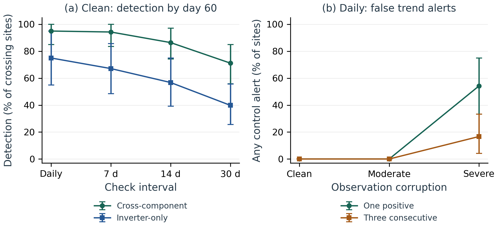

# Supplement S1: Exploratory automated-check timing

Oyewale, D.O. and Meyer-Petgrave, F.

Companion to the NASEF 2026 methodological paper. This secondary analysis is post-hoc; it does not alter the primary synthetic benchmark or establish field effectiveness.

## S1. Methods and disclosure

This post-hoc extension was specified on 6 October 2026 after the original evaluation and with prior exposure to proposed timing results. Its explicit protocol preceded the present execution, but the analysis is exploratory and not preregistered or independent validation. The frozen simulator, policy and thresholds were unchanged. We reused all 24 evaluation installations, four trend episodes, four access conditions and three stress levels. The tool ran at each day's final sample from day 14 through day 60, with future rows excluded, producing 54,144 decisions. All 288 observed-input fingerprints and 1,152 day-60 labels matched the corresponding frozen benchmark records; all 96 clean trend trajectories passed physical checks.

Injected decline increases linearly to a final loss sampled from 3.5–18%. The scoring reference is the first local day whose mean latent loss across 96 samples reaches 5%. This is an operational threshold, not physical fault onset or the tool's early-versus-late median statistic. Latent loss is used only in evaluation. Twenty trajectories crossed the reference within 60 days; four did not and were scored separately for alerts. Stable performance, declining irradiance and static low efficiency supplied three non-decline controls.

Automated checks occur every 1, 7, 14 or 30 days. For period p, every phase from 0 to p−1 is considered, with checks on days 14+phase+k p up to day 60 and no extra forced final check. Phases represent alternative schedules, not independent installations. The primary rule alerts on one positive check. An exploratory sensitivity requires three consecutive scheduled positive checks, resetting on normal or unknown; it cannot use intervening unscheduled decisions. Three monthly positives are infeasible in this horizon.

Detection requires an alert on or after the reference day; earlier alerts are recorded separately and monitoring continues. Delay is the first qualifying alert day minus the reference day. Conditional means pool detected installation-phase combinations and exclude misses; consequently, differences between those means are not paired effects. A finite-horizon waiting score assigns the observed delay to detections and 61 minus reference day to misses. Phases are averaged within installation before paired schedule contrasts and 2,000 installation-bootstrap draws (seed 20261006). This score measures waiting within the defined horizon, not eventual detection time. False-trend-alert probability is the fraction of installations with any alert across the three controls; per-control and per-check rates remain archived. The rolling experiment and the conversational pilot are separate: an automatic-alert-to-conversation interaction was not tested.

## S2. Results and interpretation

Under clean full-history cross-component access, daily checks detected 19/20 reference-crossing declines, with a conditional mean delay of 4.79 days. Table S1 shows periodic schedules. Monthly checks detected 14.23/20 on average across phases, with a pooled conditional mean delay of 16.50 days. The paired finite-horizon waiting-score difference between monthly and daily was 11.73 days (95% installation-bootstrap interval: 9.88–13.35). This contrast includes all 20 crossing installations and their misses; it is distinct from subtracting conditional mean delays.

Table S1. Clean full-history cross-component timing with one positive check. Periodic counts average all schedule phases. Conditional delay excludes missed cases; waiting score includes them. Reference-crossing denominator: 20 installations.

| Check interval | Detected, average /20 | Mean conditional delay (days) | Mean waiting score (days) |
|---|---:|---:|---:|
| Daily | 19.00 | 4.79 | 5.05 |
| Every 7 days | 18.86 | 7.74 | 7.90 |
| Every 14 days | 17.29 | 10.61 | 11.00 |
| Every 30 days | 14.23 | 16.50 | 16.78 |

No clean full-history cross-component control trajectory raised a false trend alert during daily checks. Under severe corruption, 13/24 installations had an alert on at least one control; requiring three consecutive daily positives reduced that count to 4/24, while post-reference detection fell from 19/20 to 18/20. Pre-reference alerts occurred in 16/20 crossing declines under the one-positive rule and 7/20 under persistence. They precede the chosen 5% threshold, not necessarily the start of loss. Clean inverter-only daily checks raised a false trend alert on at least one control in every installation. Earlier flags therefore cannot be interpreted without their false-alarm cost.

Daily checks contain every periodic check under the one-positive rule, so earlier or equal qualifying detection follows from the schedule design. The experiment quantifies the magnitude of delays, misses and false-alert exposure under this policy; it does not establish diagnostic superiority over installers or an optimal field cadence. Recent-only access cannot satisfy the unchanged tool's 14-day history requirement. The phase-level archive retains these abstentions, below-threshold trajectories and infeasible persistence schedules rather than excluding them from reporting.

## S3. Reproducibility

The accompanying NASEF2026_Timing_Reproducibility.zip contains the protocol, analysis and verification scripts, archived decisions, schedule-phase outcomes, input hashes and interpretation plots. Follow docs/DETECTION_DELAY_GUIDE.md in that package. No new experiments were run for this editorial revision.
