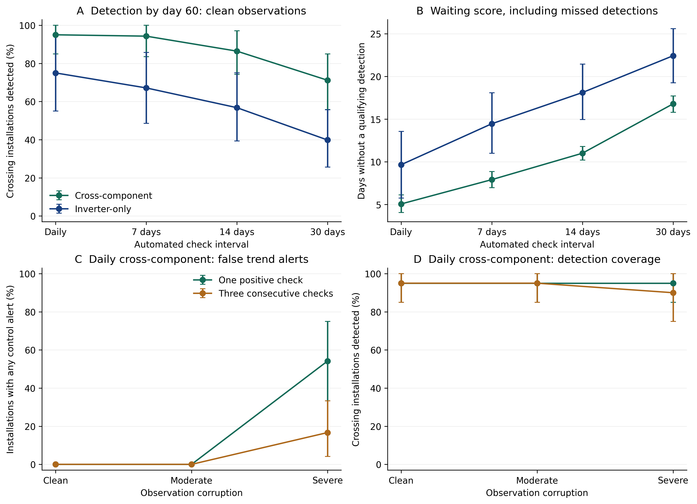

# Exploratory timing experiment: interpretation

Linked [frozen run](../20261006T022136185304Z_detection_delay/REPORT.md). This is synthetic, exploratory evidence, not a field or installer comparison. No Claude calls were made.

All 24 evaluation installations were reused; 20 decline trajectories crossed the 5% daily-mean loss reference and 4 did not. Four trend episodes, three stress levels, four access conditions and 47 daily checkpoints produced 54,144 decisions.

## Clean observations: full-history cross-component access

| Check interval | Detected, phase-average | Mean delay among detected | Waiting score including misses | Extra waiting versus daily (95% cluster interval) |
|---|---:|---:|---:|---:|
| 1 day(s) | 19.00/20 (95.0%) | 4.79 days | 5.05 days | Reference |
| 7 day(s) | 18.86/20 (94.3%) | 7.74 days | 7.90 days | 2.85 [2.55, 3.00] |
| 14 day(s) | 17.29/20 (86.4%) | 10.61 days | 11.00 days | 5.95 [5.20, 6.42] |
| 30 day(s) | 14.23/20 (71.2%) | 16.50 days | 16.78 days | 11.73 [9.88, 13.35] |

Periodic fractional counts are averages over schedule phases. Conditional delays exclude misses and use different detected subsets; use the paired waiting-score comparison for schedule contrasts. The waiting score assigns 61 minus reference day to misses, so it does not estimate eventual delay.

## Daily checks: coverage and false alarms

| Stress | Access | Required consecutive positives | Detected after reference | Any pre-reference alert | Any control alert |
|---|---|---:|---:|---:|---:|
| clean | full_cross | 1 | 95.0% | 0.0% | 0.0% |
| clean | full_cross | 3 | 95.0% | 0.0% | 0.0% |
| clean | full_inverter | 1 | 75.0% | 65.0% | 100.0% |
| clean | full_inverter | 3 | 70.0% | 50.0% | 95.8% |
| moderate | full_cross | 1 | 95.0% | 45.0% | 0.0% |
| moderate | full_cross | 3 | 95.0% | 25.0% | 0.0% |
| moderate | full_inverter | 1 | 75.0% | 65.0% | 100.0% |
| moderate | full_inverter | 3 | 70.0% | 55.0% | 100.0% |
| severe | full_cross | 1 | 95.0% | 80.0% | 54.2% |
| severe | full_cross | 3 | 90.0% | 35.0% | 16.7% |
| severe | full_inverter | 1 | 80.0% | 65.0% | 100.0% |
| severe | full_inverter | 3 | 75.0% | 55.0% | 95.8% |

False alerts here mean a pv_decline diagnosis in at least one stable, changing-weather or static-low-efficiency control. Their denominator is 24 installations. Pre-reference alerts concern the reference-crossing decline group; they are not proof that no loss existed.

Figure: installation-bootstrap 95% intervals; phases averaged within installation. Upper panels use one positive check. Lower panels compare one versus three consecutive daily positives with full-history cross-component access.

## Limits and manuscript use

- Use these independently generated values, not unverified draft numbers. Similar numerical values would not establish identical definitions or provenance.
- The reference is injected daily-mean loss, whereas the policy compares early and late observed medians. Neither is physical field fault onset.
- Three monthly positives are impossible in this observation window; their zero detection is a horizon limitation, not a useful competitor result.
- Recent-only access cannot supply the existing trend tool with its required 14 days; report its abstentions, not a general failure of all recent-data methods.
- Repeated checks create more opportunities for false alarms. Any-control alert probability and per-check rates answer different questions.
- The same authored simulator, installations and policy are reused. The analysis was specified after seeing proposed results and is exploratory.
- For the one-positive rule, daily checks include every periodic check by construction. Earlier or equal detection is structurally expected; the experiment quantifies delay, misses and false-alert exposure, not a new diagnostic superiority.
- No field accuracy, prevented incidents, technician performance, or optimal check interval is established.
- This report does not update the accepted abstract or full-paper numerical claims.
